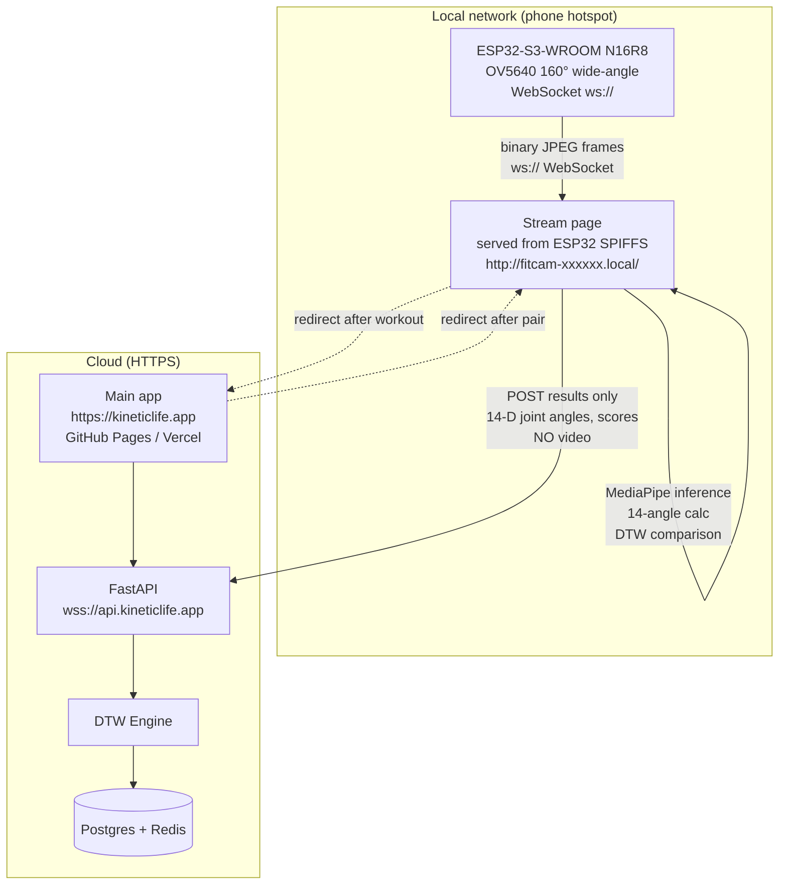
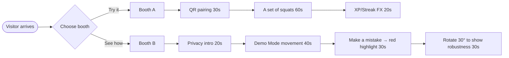

# 00 · System Overview

> **Version**: v0.3 · **Status**: 6-week Demo Day sprint
>> **Primary goal**: Successful Demo Day on 2-booth setup, 6 weeks from now
> **Secondary goal**: Reserve interfaces for 10–1000 user scaling (**not implemented before Demo**)

---

## §1 Project Overview

**One-liner**: Freenove ESP32-S3-WROOM Board (N16R8) FNK0085 B with OV5640 captures video → browser extracts 3D pose with MediaPipe locally → cloud receives only 14-D joint angles → DTW analyzes → returns correctness + problem joints, gamified with a Duolingo-style loop.

**Hardware baseline**: Freenove ESP32-S3-WROOM Board (N16R8), model **FNK0085 B**, camera **OV5640 160° wide-angle**. Firmware pin mapping, camera resolution/FPS tuning, and Demo Day calibration assume this hardware.

**Privacy core**: Raw video never leaves the local network. MediaPipe runs entirely in the browser on the local stream page. Only 14-D joint angles (already de-identified and view-invariant) are sent to the cloud. The cloud never receives video frames or raw landmarks.

---

## §2 Team Roles & Document Index

| Document | Audience | Owner |
|-----|------|---------|
| **This document** | Everyone + judges | Overview / external |
| [`01_IoT_ESP32S3.md`](./01_IoT_ESP32S3.md) | IoT engineer | ESP32-S3 firmware, MJPEG, QR pairing |
| [`02_Web_MediaPipe.md`](./02_Web_MediaPipe.md) | Frontend engineer | PWA, MediaPipe Pose, gesture detection, Demo Mode |
| [`03_Cloud_DTW.md`](./03_Cloud_DTW.md) | Backend engineer | FastAPI+WS, DTW, pluggable classifier, async coaching advice |
| [`04_Interface_Contracts.md`](./04_Interface_Contracts.md) | **All required** | Cross-platform data formats, protocols, joint angle defs |

**Collaboration rule**: Any interface field change requires **first updating 04 → 3-way review → then implementing in role docs**. This is the only hard rule.

---

## §3 Architecture

### 3.1 Data Flow

**Privacy guarantee**: The local stream page is served over `http://` from the ESP32 itself (SPIFFS), so `ws://` connections are not mixed content. Video frames never leave the local hotspot network. Only 14-D joint angles and DTW scores travel to the cloud API.

### 3.2 Web Hosting Architecture

The browser's mixed-content policy blocks `ws://` (insecure WebSocket) from an `https://` page. Rather than adding TLS to ESP32 (complex, bad UX with self-signed certs) or routing video through a relay server (privacy cost), the project uses a two-layer approach:

| Layer | Host | Protocol | Content |
|-------|------|----------|---------|
| Main app (login, courses, history) | GitHub Pages / Vercel | HTTPS | Business logic only |
| Stream + inference page | ESP32 SPIFFS | HTTP (local) | Video + pose, local only |

After pairing, the main app redirects the browser to `http://fitcam-xxxxxx.local/` (ESP32 SPIFFS page). The SPIFFS page POSTs workout results back to `https://api.kineticlife.app` — an HTTP page requesting an HTTPS resource is allowed by browsers (this is the reverse of mixed content). When the workout ends, the page redirects back to the main app.

No relay server is needed for video. The relay approach was evaluated and rejected because it would route raw video frames through a third-party server, breaking the privacy guarantee.

### 3.3 Main-Path Latency Budget (P95 ≤ 400 ms)

| Stage | Budget |
|-------|--------|
| ESP32 → browser (local WiFi, WebSocket) | 20–50 ms |
| MediaPipe inference (local) | 20–40 ms |
| 14-angle calculation (local) | <5 ms |
| Browser → cloud API | 80–150 ms |
| Classifier + DTW | 80–120 ms |
| Cloud → browser | 80–150 ms |
| **Total** | **~350 ms** |

---

## §4 Demo Day — Two Booths

**Time**: 6 weeks from now · **Conditions**: Idealized (close range, single subject, mostly facing camera, controlled lighting)

### 4.1 Booth A · Phone Full-Experience

| Item | Setup |
|----|------|
| Hardware | Freenove ESP32-S3-WROOM FNK0085 B + OV5640 unit #1 + demo phone |
| Modes | Duolingo + Jump-in + QR pairing |
| Experience | Visitors use the demo phone, OR scan a QR to connect their own phone (new-user flow) |
| Focus | Full user flow, gamified UI, pairing experience |
| Latency | Main path ≤ 400 ms (real-time feedback) |

### 4.2 Booth B · iPad Main-Function Showcase

| Item | Setup |
|----|------|
| Hardware | Freenove ESP32-S3-WROOM FNK0085 B + OV5640 unit #2 + iPad (landscape) |
| Mode | **Demo Mode** (skeleton + visual FX, no video) |
| Experience | Visitor performs a complete set, system shows full analysis |
| Focus | **Privacy** (no video on screen) + **DTW accuracy** (joint highlight, view-angle robustness) |
| Latency | 1–2 s post-set acceptable for the deeper analysis |

### 4.3 Demo Script (2–3 min per visitor)

---

## §5 6-Week Milestones × 3-Person Responsibility Matrix

| Week | Overall goal | IoT (01) | Web (02) | Cloud (03) |
|---|--------|---------|---------|-----------|
| **W1** | Hardware streams; Web shows skeleton | **MJPEG firmware + LED** | Pull ESP32 stream + skeleton render | FastAPI+WS scaffold + echo |
| **W2** | End-to-end skeleton + standard templates recorded | **QR pairing done** + stability test | MediaPipe 3D + **14-angle calc** | Recording script + Postgres schema |
| **W3** | DTW works + single action verified | (maintain) | Edge DTW + segmenter | **dtaidistance engine + 3 templates** |
| **W4** | Full hands-free interaction | (maintain) | **Gesture + auto rep counter** + Jump-in | SVM classifier + server-side DTW verify |
| **W5** | Duolingo + coaching advice | (maintain) | Slim Duolingo UI + courses | **Async advice triggers** |
| **W6** | Two-booth deploy + dry runs | **2nd ESP32 + iPad bring-up** | iPad UI tuning + Demo Mode polish | Fallbacks + monitoring |

**Part-time effort estimate** (3 engineers × 6 weeks):

| Role | Hours/week | Total |
|-----|---------|------|
| IoT | 8–10 h | ~50 h |
| Web | 12–15 h | ~80 h |
| Cloud | 10–12 h | ~65 h |
| **Combined** | — | **~195 h** |

---

## §6 Non-Functional Requirements

| Aspect | Target |
|--------|--------|
| Latency | Main path ≤ 400 ms (P95) |
| Privacy | Zero video upload; stream page served from ESP32 SPIFFS (local HTTP); only 14-D joint angles reach cloud |
| Availability | 99% during Demo (single instance is enough); offline Demo Mode if WiFi fails |
| Cost | < $30/month (Fly.io + Neon + Upstash free tiers + low-cost advice generation) |

Implementation details in role docs.

---

## §7 Top 5 Risks

| Risk | Likelihood | Impact | Mitigation |
|-----|-----|------|------|
| Venue WiFi unstable | Med | High | Bring backup 4G router + Demo Mode offline fallback |
| ESP32 low-light noise → MediaPipe misdetects | Med | High | Fill light + locked white balance |
| DTW thresholds don't generalize across body types | High | Med | Calibrate against user's own 3 baseline reps |
| iPad frame rate drops below 20 FPS at venue | Med | Med | Demo Mode uses Canvas 2D (chosen); turn off extras |
| 3-way contract drift | Med | High | **Walkthrough 04 weekly + integration milestone end of W3** |

---

## §8 Decisions Pending Dennis (before Demo Day)

1. **Standard template source**: (A) record ourselves / (B) public dataset (MM-Fit) — recommend A; just 3 actions (squat / pushup / plank)
2. **View-angle robustness validation window**: 1 day in W3 collecting 0°/30°/45° data, comparing DTW distances

---

## §9 Extension Placeholders (post-Demo)

> Note: This section is **future scope**. Not implemented before Demo, only mentioned in the pitch deck.

| Extension | Now | Future | Reservation |
|-------|------|-----|---------|
| User scale | Single instance ~100 | 1000+ multi-instance + queue + sharding | FastAPI is already stateless |
| Classifier | SVM | CNN / ST-GCN / Transformer | `ActionClassifier` Protocol (03 §5) |
| Action library | 3 actions | 30+ | Template schema already extensible |
| Multi-view | worldLandmarks angles only | Multi-view template fallback | `view_angle` column reserved |
| Face recognition | Not done | Web-side MediaPipe Face Landmarker | Web is modular |

Detailed evolution plan lives in the archived v0.3 main doc under `_archive_v0.3/`, §10.

---

## §10 Out of Scope (this system does NOT cover)

- Hardware mass production, casing, battery management (assume USB-powered)
- Payment / subscription
- Multi-user same-screen / social
- Medical-grade rehab assessment

---

*Last updated: 2026-04-24*
