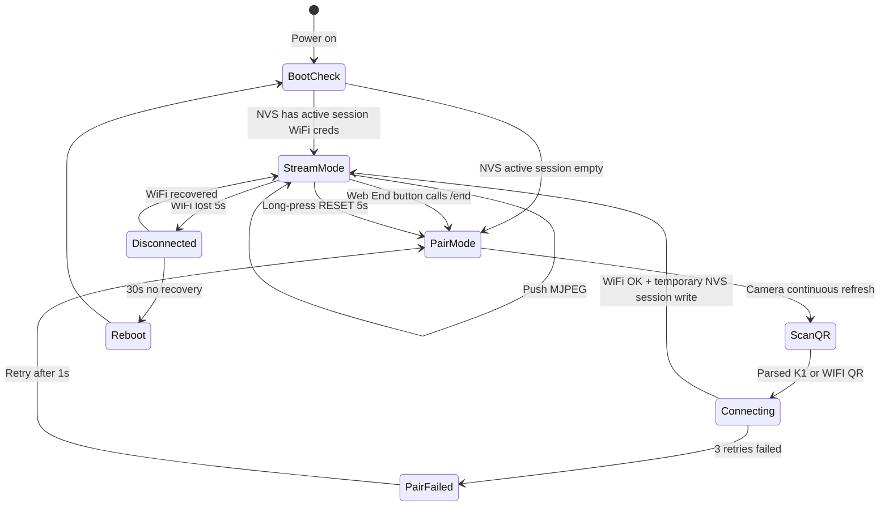
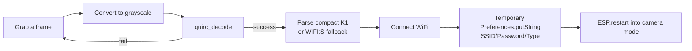

# 01 · IoT / ESP32-S3 Firmware

> **Version**: v0.3
> **Audience**: IoT engineer
> **Contracts**: For any external data format, MUST read [`04_Interface_Contracts.md`](./04_Interface_Contracts.md) §2 and §6

---

## §1 Scope & External Commitments

| You own | You don't own |
|-----------|-------------|
| Board selection + soldering + bring-up | MediaPipe / Web UI / DTW algorithm |
| ESP32 firmware (MJPEG + QR pairing + LED + watchdog) | Cloud services |
| Honoring [04 §2 contract](./04_Interface_Contracts.md#2-esp32--phone-local-wifi): `/hello`, `/stream`, mDNS, WiFi QR parsing | Protocol field definitions (in 04) |
| Hardware reliability for both demo units on Demo Day | |

**External commitment (one-liner)**:
- After power-on or QR pairing, ESP32 self-reports via **HTTP /hello** and streams MJPEG via **HTTP /stream**.
- Frame rate ≥ 12 FPS at 240×240; 30+ minutes continuous operation without drops.

---

## §2 Hardware Baseline

**Current board**: **Freenove ESP32-S3-WROOM Board (N16R8), FNK0085 B**

**Camera**: **OV2640**

**Hardware reference**: [Freenove ESP32-S3-WROOM Board GitHub](https://github.com/Freenove/Freenove_ESP32_S3_WROOM_Board)

Why:
- ESP32-S3-WROOM module with **16 MB Flash + 8 MB PSRAM** (`N16R8`), enough for MJPEG buffering and QR decode work.
- Freenove board is the team calibration target, so firmware pin mapping and camera bring-up should be validated against **FNK0085 B** first.
- OV2640 is the active camera module for resolution, exposure, white-balance, and low-light tuning.
- Full Arduino / PlatformIO workflow remains suitable for the demo firmware.

**Board assumptions to verify during bring-up**:

| Item | Baseline value | Why it matters |
|----|------|------|
| Board model | Freenove ESP32-S3-WROOM Board (N16R8), FNK0085 B | Pin map and boot behavior |
| Flash / PSRAM | 16 MB Flash / 8 MB PSRAM | MJPEG frame buffers, QR decode memory |
| Camera | OV2640 | Camera driver, frame size, exposure tuning |
| Default stream | 240×240 @ 15 FPS | Shared target for web pose extraction |

**Alternatives** are not part of v0.3 calibration. If a backup board is used, create a separate pin-map note before flashing.

**Auxiliary**:
- USB-C power supply (5V/2A)
- Small tripod or clip mount
- **5V fill light** (REQUIRED — OV2640 noise in low light kills MediaPipe accuracy)
- Short USB-C cable (<30 cm, less noise)

---

## §3 Firmware Architecture

**Framework**: **Arduino IDE + PlatformIO** (faster ramp than ESP-IDF; sufficient for demo)

**Suggested layout**:
```
firmware/
├── platformio.ini
├── src/
│   ├── main.cpp         # setup() + loop()
│   ├── camera_init.cpp  # esp_camera config
│   ├── wifi_qr.cpp      # quirc parsing + NVS write
│   ├── http_server.cpp  # /hello + /stream routes
│   ├── led.cpp          # RGB status indicator
│   └── watchdog.cpp     # task watchdog
└── data/                # SPIFFS, empty
```

**Core libraries**:
- `esp_camera` (Espressif official)
- `quirc` (C-language QR decoder, ~600 LOC)
- `WiFi.h` + `WebServer.h`
- `Preferences.h` (NVS wrapper)

---

## §4 State Machine & LED Codes



**RGB LED color codes** (single RGB LED is enough):

| Color | Pattern | Meaning |
|-----|---------|------|
| Blue | Blink (1Hz) | Pairing mode, awaiting QR |
| Yellow | Blink (2Hz) | QR parsed, connecting WiFi |
| Green | Solid | WiFi OK + HTTP server up |
| Green | Fast blink (4Hz) | Client is pulling stream |
| Red | Blink (1Hz) | Connection failed |
| Red | Solid | Fatal error (e.g. camera init failure) |

Current firmware maps the RGB status LED to `STATUS_RGB_PIN=48` in `platformio.ini`. If the Freenove board revision uses a different onboard RGB pin, update that build flag.

---

## §5 MJPEG Service Implementation

**Key config**:

```cpp
// camera_init.cpp excerpt
camera_config_t config;
config.pixel_format = PIXFORMAT_JPEG;
config.frame_size = FRAMESIZE_240X240;  // default; resolutions are switchable
config.jpeg_quality = 12;               // 0-63, lower = better; 12 visually OK
config.fb_count = 2;                    // double buffer for stable FPS
config.grab_mode = CAMERA_GRAB_LATEST;  // always send the freshest frame
config.fb_location = CAMERA_FB_IN_PSRAM; // MUST use PSRAM
```

**HTTP routes**:

| Path | Method | Purpose | Contract |
|-----|------|------|---------|
| `/hello` | GET | device_id / fw_version / capabilities | [04 §2.3](./04_Interface_Contracts.md#23-http-handshake-hello) |
| `/status` | GET | current state, WiFi RSSI/IP, camera mode/settings, memory | Debug/status |
| `/stream` | GET | multipart MJPEG; per-frame `X-Frame-Id` + `X-Timestamp-Ms` | [04 §2.4](./04_Interface_Contracts.md#24-mjpeg-stream-stream) |
| `/end` | POST/GET | clear temporary WiFi session in NVS and reboot to QR pairing | Demo session lifecycle |
| `/ctrl` | POST | placeholder, not in v0.3 | — |

**MJPEG framing** (simplified pseudocode):

```cpp
void streamHandler(WebServer& server) {
  server.sendContent("HTTP/1.1 200 OK\r\n");
  server.sendContent("Content-Type: multipart/x-mixed-replace; boundary=frame\r\n\r\n");

  uint32_t frame_id = 0;
  while (client.connected()) {
    camera_fb_t* fb = esp_camera_fb_get();
    if (!fb) continue;

    char header[256];
    int n = snprintf(header, sizeof(header),
      "--frame\r\n"
      "Content-Type: image/jpeg\r\n"
      "Content-Length: %u\r\n"
      "X-Frame-Id: %u\r\n"
      "X-Timestamp-Ms: %lld\r\n\r\n",
      fb->len, frame_id++, esp_timer_get_time() / 1000);

    client.write(header, n);
    client.write(fb->buf, fb->len);
    client.write("\r\n", 2);

    esp_camera_fb_return(fb);
    vTaskDelay(pdMS_TO_TICKS(66));  // ~15 FPS
  }
}
```

**Max JPEG size**: 128 KB (per contract); drop if exceeded. At 240×240 @ q=12, frames are typically 8–15 KB, well under the limit.

---

## §6 WiFi QR Pairing

**QR format**: current web uses compact `K1:<type>:<ssid_len>:<ssid><pass>` payloads; firmware also accepts `WIFI:S:<ssid>;T:<WPA|WEP|nopass>;P:<pass>;;` for compatibility (see [04 §2.1](./04_Interface_Contracts.md#21-wifi-qr-string-format-phone--esp32-one-shot-pairing)).

**Implementation flow**:



**quirc integration notes**:
- `quirc_resize(qr, w, h)` → `quirc_begin/end` feeds grayscale pixels
- Convert grayscale from OV2640 RGB565
- Try decode every 200 ms — **NOT every frame** (saves power)

**Security considerations**:
- Write password directly to NVS, never log to serial
- Store SSID/password/type in the `wifi` NVS namespace only for the active demo session
- Web Camera page must call `/end` when the user finishes; ESP32 clears the NVS session and reboots to QR pairing mode

**Reset entry**:
- Long-press GPIO button 5s → `Preferences.clear()` → reboot into pairing mode

---

## §7 Power, Stability, Tuning

| Item | Setting |
|---|------|
| CPU frequency | 240 MHz (default) |
| WiFi sleep | **Disabled** (`WiFi.setSleep(false)`) — critical for demo, USB power is sufficient |
| Task watchdog | 30 s |
| Client disconnect detection | Check `client.connected()` per frame; idle after 5 s for power saving |

**Demo Day on-site checklist**:

```
[ ] LED states correct after power-on (blue→green)
[ ] Phone hits http://fitcam-XXXXXX.local/hello → returns JSON
[ ] Browser  shows continuous video
[ ] 30 min continuous run with no resets (do this on W6 weekend)
[ ] Backup pre-paired ESP32 ready
[ ] Fill light positioned, low-light scenario tested
```

---

## §8 6-Week Milestones

| Week | Your goal | Acceptance criteria |
|---|---------|---------|
| **W1** | MJPEG firmware + LED state machine | Browser sees ≥ 12 FPS on any router; LED states correct |
| **W2** | QR pairing across networks | Demo: pair with 3 different hotspots without reflashing firmware |
| **W3** | Stability burn-in | 60 min continuous stream with no reboot; under fill light, MediaPipe misdetect rate < 5% |
| **W4** | (support Web integration) | `/hello` aligns with `client_capabilities`; verify timestamp precision |
| **W5** | (maintenance + occasional bugs) | Deliver 1-week stability report |
| **W6** | Second unit + venue setup | Day before Demo: both units cold-boot to streaming in < 30s |

**Total estimate**: ~50 h (part-time, 8–10 h/week)

---

## §9 Risks (IoT Perspective)

| Risk | Likelihood | Impact | Mitigation |
|-----|-----|------|------|
| OV2640 low-light noise | High | High | 5V fill light + lock white balance + control venue lighting |
| PSRAM config missed → boot crash | Med | Med | platformio.ini configured AND tested with full build + boot once |
| Venue WiFi interference | Med | High | Backup 4G router; phone hotspot must be 2.4 GHz |
| Camera connection loose | Low | High | Tape + hot glue before Demo |
| `quirc` parsing fails in low light | Med | Med | Pairing mode UI guidance: **screen brightness 100%** + 30 cm distance |

---

## §10 Extension Placeholders (post-Demo)

> Note: Outside the 6-week sprint.

- **WebRTC instead of MJPEG**: latency under 100 ms, but requires full SRTP/DTLS stack on ESP32; future optimization
- **OTA upgrade**: ESP-IDF built-in, post-Demo
- **Multi-device coexistence**: mDNS name already includes MAC suffix, no contract change needed
- **Sensor reporting (gyro / temperature)**: add as optional fields in `/hello` (per §1.3 additive rule)

---

## §11 Contract Quick-Reference

| What you need | Jump to |
|---------|------|
| WiFi QR string fields | [04 §2.1](./04_Interface_Contracts.md#21-wifi-qr-string-format-phone--esp32-one-shot-pairing) |
| `/hello` JSON fields | [04 §2.3](./04_Interface_Contracts.md#23-http-handshake-hello) |
| `/stream` frame headers | [04 §2.4](./04_Interface_Contracts.md#24-mjpeg-stream-stream) |
| Protocol versioning | [04 §1.3](./04_Interface_Contracts.md#13-global-conventions) |

---

*Last updated: 2026-04-24*
