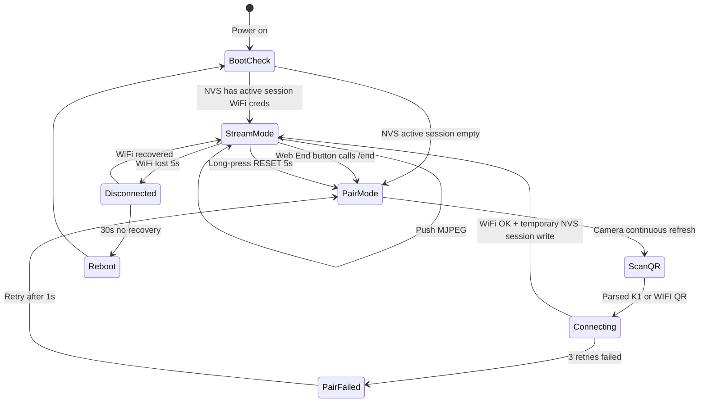
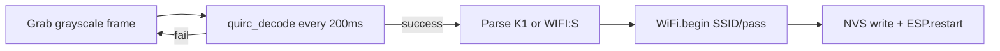

# 01 · IoT / ESP32-S3 Firmware

> **Version**: v0.3
> **Audience**: IoT engineer
> **Contracts**: For any external data format, MUST read [`04_Interface_Contracts.md`](./04_Interface_Contracts.md) §2 and §6

---

## §1 Scope & External Commitments

| You own | You don't own |
|-----------|-------------|
| Board selection + soldering + bring-up | MediaPipe / Web UI / DTW algorithm |
| ESP32 firmware (WebSocket streaming + QR pairing + LED + watchdog) | Cloud services |
| Honoring [04 §2 contract](./04_Interface_Contracts.md#2-esp32--phone-local-wifi): `/hello`, `/ws`, mDNS, WiFi QR parsing | Protocol field definitions (in 04) |
| Hardware reliability for both demo units on Demo Day | |

**External commitments**:
- After power-on or pairing (QR or Soft AP), ESP32 self-reports via **HTTP /hello** and streams binary JPEG frames via **WebSocket /ws**.
- Serves the stream + inference page from **SPIFFS** at `http://fitcam-xxxxxx.local/` so the browser can connect to `ws://` without mixed-content issues.
- Frame rate target ≥ 9 FPS at 320×240 JPEG on the OV2640/140° calibration hardware; 30+ minutes continuous operation without drops.

---

## §2 Hardware Baseline

**Current board**: **Freenove ESP32-S3-WROOM Board (N16R8), FNK0085 B**

**Camera**: **OV2640 140° wide-angle**

**Hardware reference**: [Freenove ESP32-S3-WROOM Board GitHub](https://github.com/Freenove/Freenove_ESP32_S3_WROOM_Board)

Why:
- ESP32-S3-WROOM module with **16 MB Flash + 8 MB PSRAM** (`N16R8`), enough for WebSocket buffering and QR decode work.
- Freenove board is the team calibration target, so firmware pin mapping and camera bring-up should be validated against **FNK0085 B** first.
- OV2640 140° wide-angle is the active camera module for resolution, exposure, white-balance, and low-light tuning.
- Full Arduino / PlatformIO workflow remains suitable for the demo firmware.

**Board assumptions to verify during bring-up**:

| Item | Baseline value | Why it matters |
|----|------|------|
| Board model | Freenove ESP32-S3-WROOM Board (N16R8), FNK0085 B | Pin map and boot behavior |
| Flash / PSRAM | 16 MB Flash / 8 MB PSRAM | WebSocket frame buffers, QR decode memory |
| Camera | OV2640 140° wide-angle | Camera driver, frame size, exposure tuning |
| Default stream | 320×240 @ 9 FPS target | OV2640/140° calibration target at QVGA JPEG |

**Alternatives** are not part of v0.3 calibration. If a backup board is used, create a separate pin-map note before flashing.

**Auxiliary**:
- USB-C power supply (5V/2A)
- Small tripod or clip mount
- **5V fill light** (REQUIRED — OV2640 noise in low light kills MediaPipe accuracy)
- Short USB-C cable (<30 cm, less noise)

---

## §3 Firmware Architecture

**Framework**: **Arduino IDE + PlatformIO** (faster ramp than ESP-IDF; sufficient for demo)

**Actual layout**:
```
firmware/
├── platformio.ini
├── src/
│   ├── main.cpp          # setup() + loop()
│   ├── camera_init.cpp   # esp_camera config, OV2640 defaults
│   ├── wifi_qr.cpp       # quirc parsing + NVS write
│   ├── http_server.cpp   # REST + WebSocket /ws
│   ├── status_led.cpp    # RGB status indicator
│   └── debug_log.cpp     # serial logging helpers
└── data/                 # SPIFFS root — stream page served from here
    └── index.html        # stream + inference page (MediaPipe)
```

**Core libraries**:
- `esp_camera` (Espressif official)
- `ESPAsyncWebServer` + `AsyncWebSocket` (non-blocking WS)
- `quirc` (C-language QR decoder)
- `WiFi.h` + `Preferences.h` (NVS wrapper)
- `ESPmDNS`

---

## §4 State Machine & LED Codes



**RGB LED color codes** (single RGB LED is enough):

| Color | Pattern | Meaning |
|-----|---------|------|
| Blue | Blink (1Hz) | Pairing mode, awaiting QR |
| Yellow | Blink (2Hz) | QR parsed, connecting WiFi |
| Green | Solid | WiFi OK + HTTP server up |
| Green | Fast blink (4Hz) | Client is pulling stream |
| Red | Blink (1Hz) | Connection failed |
| Red | Solid | Fatal error (e.g. camera init failure) |

Current firmware maps the RGB status LED to `STATUS_RGB_PIN=48` in `platformio.ini`. If the Freenove board revision uses a different onboard RGB pin, update that build flag.

---

## §5 WebSocket Streaming

**Transport**: Binary WebSocket (`ws://fitcam-xxxxxx.local/ws`). Each message is one complete JPEG frame. Firmware uses a latest-frame policy: each frame is sent only to clients whose WebSocket queue is empty; slow clients skip stale frames instead of building a delayed queue. `esp_camera_fb_return()` is called right after send attempts, safe because accepted frames are already copied.

**Key camera config**:

```cpp
// camera_init.cpp
config.pixel_format = PIXFORMAT_JPEG;
config.frame_size   = FRAMESIZE_QVGA;   // 320×240 default; switchable via /cam
config.jpeg_quality = 12;               // lower = better; tunable via /cam?q=
config.fb_count     = 2;               // PSRAM double-buffer, eliminates DMA contention
config.grab_mode    = CAMERA_GRAB_LATEST;
config.fb_location  = CAMERA_FB_IN_PSRAM;
```

**OV2640 sensor defaults** (set at init):

```cpp
s->set_brightness(s, 0);   s->set_contrast(s, 1);
s->set_saturation(s, 0);   s->set_sharpness(s, 1);
s->set_bpc(s, 1);          s->set_wpc(s, 1);   s->set_lenc(s, 1);
s->set_whitebal(s, 1);     s->set_awb_gain(s, 1);
s->set_gain_ctrl(s, 1);    s->set_exposure_ctrl(s, 1);   s->set_aec2(s, 1);
```

**HTTP + WS routes**:

| Path | Method | Purpose |
|------|--------|---------|
| `/` | GET | Serves SPIFFS `index.html` (stream + inference page) |
| `/ws` | WS | Binary JPEG stream |
| `/hello` | GET | device_id, fw_version, state, ws_clients |
| `/status` | GET | WiFi RSSI, camera mode/settings, memory stats |
| `/capture` | GET | Single JPEG snapshot |
| `/cam` | GET/POST | Live camera tuning: `?res=&q=&brightness=&contrast=&saturation=&sharpness=&ae_level=&vflip=&hmirror=` |
| `/end` | GET/POST | Clear NVS credentials and reboot to pairing mode |

**SPIFFS page**: `data/index.html` is served at the root. Because the page is on `http://`, it can open `ws://` without mixed-content issues. The page POSTs workout results back to the cloud API over HTTPS (an HTTP page requesting an HTTPS resource is allowed).

**Max JPEG size**: 256 KB limit (raised from 128 KB to support VGA frames). At 320×240 q=12, frames are typically 15–40 KB. VGA (640×480) frames can reach 80–150 KB.

**Resolution switching**: DMA buffers are allocated at init time. Switching to a larger frame size requires `esp_camera_deinit()` + reinit. `camera_set_framesize()` handles this automatically when the new size exceeds the init allocation.

---

## §6 WiFi Pairing — Two Paths

Both paths run simultaneously while the device is in pairing mode (blue LED blinking). Either can complete pairing.

### Path A — Soft AP (recommended, primary path)

1. ESP32 broadcasts `KineticLife-Setup` / password `kineticlife`
2. User connects laptop/phone to that AP
3. Opens `pair.html` → Config tab → selects target WiFi → enters password
4. ESP32 connects, saves credentials to NVS, reboots into stream mode

Soft AP IP: `192.168.4.1`. No QR scanning required; works even when the phone screen is off.

### Path B — QR Camera Scan

**QR format**: compact `K1:<type>:<ssid_len>:<ssid><pass>` (generated by `pair.html`); firmware also accepts `WIFI:S:<ssid>;T:WPA;P:<pass>;;` for compatibility.



**OV2640 note**: The 140° wide-angle lens can introduce enough barrel distortion to degrade QR ECC success rate. Soft AP is the more reliable path for this camera module. QR path still works at optimal distance (~20–30 cm) with screen at 100% brightness.

**Security**:
- Password written directly to NVS, never logged to serial
- NVS namespace `wifi`, keys: `ssid` / `pass` / `type`
- `/end` clears credentials and reboots to pairing mode

**Reset**:
- `POST /end` from the stream page, or `pio run --target erase` + reflash

---

## §7 Power, Stability, Tuning

| Item | Setting |
|---|------|
| CPU frequency | 240 MHz (default) |
| WiFi sleep | **Disabled** (`WiFi.setSleep(false)`) — critical for demo, USB power is sufficient |
| Task watchdog | 30 s |
| Client disconnect detection | Check `client.connected()` per frame; idle after 5 s for power saving |

**Demo Day on-site checklist**:

```
[ ] LED states correct after power-on (blue→green)
[ ] Phone hits http://fitcam-XXXXXX.local/hello → returns JSON
[ ] Browser WebSocket ws://.../ws receives video frames (debug.html shows ~9fps)
[ ] 30 min continuous run with no resets (do this on W6 weekend)
[ ] Backup pre-paired ESP32 ready
[ ] Fill light positioned, low-light scenario tested
```

---

## §8 6-Week Milestones

| Week | Your goal | Acceptance criteria |
|---|---------|---------|
| **W1** | MJPEG firmware + LED state machine | Browser sees ≥ 12 FPS on any router; LED states correct |
| **W2** | QR pairing across networks | Demo: pair with 3 different hotspots without reflashing firmware |
| **W3** | Stability burn-in | 60 min continuous stream with no reboot; under fill light, MediaPipe misdetect rate < 5% |
| **W4** | (support Web integration) | `/hello` aligns with `client_capabilities`; verify timestamp precision |
| **W5** | (maintenance + occasional bugs) | Deliver 1-week stability report |
| **W6** | Second unit + venue setup | Day before Demo: both units cold-boot to streaming in < 30s |

**Total estimate**: ~50 h (part-time, 8–10 h/week)

---

## §9 Risks (IoT Perspective)

| Risk | Likelihood | Impact | Mitigation |
|-----|-----|------|------|
| OV2640 low-light noise | High | High | 5V fill light + lock white balance + control venue lighting |
| PSRAM config missed → boot crash | Med | Med | platformio.ini configured AND tested with full build + boot once |
| Venue WiFi interference | Med | High | Backup 4G router; phone hotspot must be 2.4 GHz |
| Camera connection loose | Low | High | Tape + hot glue before Demo |
| `quirc` parsing fails in low light | Med | Med | Pairing mode UI guidance: **screen brightness 100%** + 30 cm distance |

---

## §10 Extension Placeholders (post-Demo)

> Note: Outside the 6-week sprint.

- **WebRTC instead of WebSocket**: latency under 100 ms, but requires full SRTP/DTLS stack on ESP32; future optimization
- **OTA upgrade**: ESP-IDF built-in, post-Demo
- **Multi-device coexistence**: mDNS name already includes MAC suffix, no contract change needed
- **Sensor reporting (gyro / temperature)**: add as optional fields in `/hello` (per §1.3 additive rule)

---

## §11 Contract Quick-Reference

| What you need | Jump to |
|---------|------|
| WiFi QR string fields | [04 §2.1](./04_Interface_Contracts.md#21-wifi-qr-string-format-phone--esp32-one-shot-pairing) |
| `/hello` JSON fields | [04 §2.3](./04_Interface_Contracts.md#23-http-handshake-hello) |
| `/ws` binary stream contract | [04 §2.5](./04_Interface_Contracts.md#25-websocket-stream-ws) |
| Protocol versioning | [04 §1.3](./04_Interface_Contracts.md#13-global-conventions) |

---

*Last updated: 2026-04-24*
