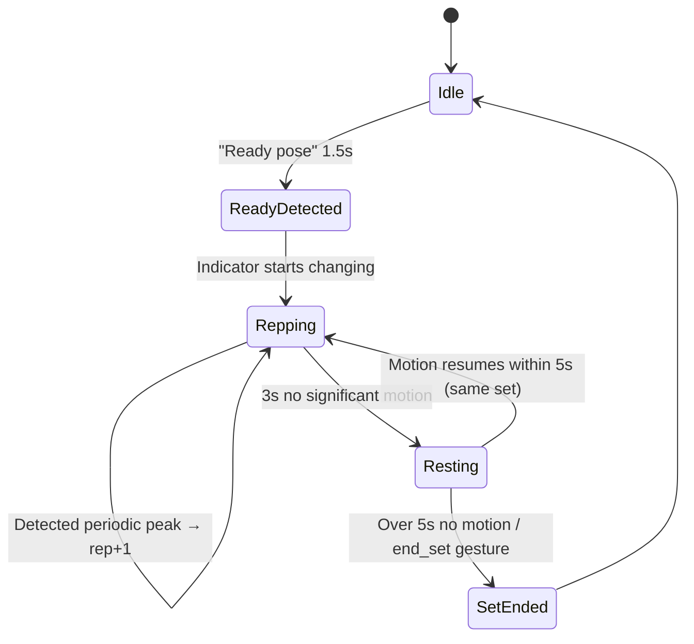

# 02 · Web Frontend + MediaPipe

> **Version**: v0.3
> **Audience**: Frontend + MediaPipe engineer
> **Contracts**: For external data formats, MUST read [`04_Interface_Contracts.md`](./04_Interface_Contracts.md) §2 / §3 / §4 / §5

---

## §1 Scope & External Commitments

| You own | You don't own |
|---------|---------------|
| **SPIFFS stream page** (`data/index.html`) — ESP32-served, local HTTP, WebSocket client | ESP32 firmware |
| **Main app** (`https://kineticlife.app`) — login, courses, history, results | DTW server implementation |
| MediaPipe Pose integration + 14-angle calc ([04 §5](./04_Interface_Contracts.md#5-14-d-joint-angle-definitions)) | Classifier training |
| DTW Web Worker (client-side, 60-frame sliding window) | Server-side advice generation |
| Gesture detection + auto rep counting (client-side) | |
| Cloud WebSocket client in main app (honoring [04 §3 / §4](./04_Interface_Contracts.md#3-phone--cloud-websocket-upstream)) | |
| Demo Day iPad UI tuning | |

**External commitments**:

- Stream page connects to `ws://fitcam-xxxxxx.local/ws` and renders skeleton overlay at ≥ 15 FPS
- 14-angle calculation must **strictly match** server formulas (shared fixture tests in §4 must pass)
- Stream page POSTs workout results to cloud API over HTTPS on session end
- Main app redirects to `http://fitcam-xxxxxx.local/` after pairing; stream page redirects back on finish

---

## §1.5 Two-Layer Web Architecture

The browser mixed-content policy blocks `ws://` connections from `https://` pages. The project solves this without a video relay server and without TLS on the ESP32:

```
https://kineticlife.app          http://fitcam-xxxxxx.local/
  (GitHub Pages / Vercel)          (ESP32 SPIFFS — local network)
────────────────────────         ──────────────────────────────
  Login / auth                     WebSocket ← binary JPEG frames
  Course library                   MediaPipe inference (local)
  Workout history       ◄─POST─    14-angle calc + DTW
  Results display         HTTPS    Workout results only (no video)
```

**Why this works**:

- The SPIFFS page is served over `http://`, so `ws://` connections are same-scheme — no mixed content.
- An `http://` page can make HTTPS `fetch()` requests to the cloud API (the restriction only goes the other way: HTTPS pages cannot load HTTP sub-resources).
- Video frames never leave the local hotspot network at any point.

**Why not a relay server**: routing video through a relay means raw frames pass through a third-party server, breaking the privacy guarantee. The SPIFFS approach avoids this entirely.

**User flow**:

1. User visits `https://kineticlife.app` — logs in, selects exercise
2. Pairs ESP32 via `pair.html` (Soft AP or QR)
3. Main app redirects to `http://fitcam-xxxxxx.local/?session=<id>&ref=https://kineticlife.app`
4. SPIFFS stream page: video streams locally, MediaPipe runs, DTW compares
5. Workout ends → SPIFFS page POSTs `{joint_angles, dtw_score, reps}` to `https://api.kineticlife.app`
6. Browser redirects back to `https://kineticlife.app/results`

---

## §2 Tech Stack

| Layer | Choice | Notes |
|---|------|------|
| Framework | **React 18 + Vite** | TS strict mode |
| State | **Zustand** | Lightweight, no Redux boilerplate |
| Styling | **Tailwind CSS** | Fast UI |
| Pose | **`@mediapipe/tasks-vision` PoseLandmarker** | MUST enable `worldLandmarks` |
| Rendering | **Canvas 2D** | Skeleton + Demo Mode FX; not Three.js |
| Routing | React Router v6 | |
| WebSocket | Native `WebSocket` + custom reconnect | |
| Offline cache | IndexedDB (via `idb`) | |
| QR generation | `qrcode` npm | For ESP32 to scan |
| PWA | Vite PWA plugin | Add to home + offline Demo Mode |

**Project layout**:
```
web/
├── public/
│   ├── manifest.json
│   └── icons/
├── src/
│   ├── main.tsx
│   ├── routes/
│   │   ├── Entry.tsx          # Dual-entry selector
│   │   ├── Pair.tsx           # WiFi QR pairing
│   │   ├── JumpIn.tsx
│   │   ├── Duolingo/
│   │   └── Demo.tsx
│   ├── capture/
│   │   ├── mjpegSource.ts     # Pull from ESP32
│   │   └── wifiQr.ts          # Generate WIFI:S:...
│   ├── pose/
│   │   ├── landmarker.ts      # MediaPipe wrapper
│   │   └── jointAngles.ts     # 14 angles (contract §5)
│   ├── edge/
│   │   ├── segmenter.ts       # Action segmentation
│   │   ├── repCounter.ts      # Auto rep (peak detection)
│   │   ├── gestureDetector.ts # Gestures
│   │   └── edgeDtw.ts         # Light DTW (rough)
│   ├── render/
│   │   ├── skeleton.tsx       # Canvas skeleton
│   │   ├── procrustes.ts      # Standard-action morphing
│   │   └── demoFx.ts          # Demo Mode FX
│   ├── api/
│   │   ├── ws.ts              # WS client (contracts §3/§4)
│   │   └── offlineQueue.ts    # Offline replay
│   ├── store/
│   │   └── session.ts         # Zustand
│   └── types/
│       └── contracts.ts       # TS types translated from §3/§4
├── vite.config.ts
└── package.json
```

---

## §3 MediaPipe Pose Integration

**Model**: `@mediapipe/tasks-vision` `PoseLandmarker` (2024+ task version, 2× faster than legacy Pose)

**Key config**:

```ts
// pose/landmarker.ts
import { PoseLandmarker, FilesetResolver } from "@mediapipe/tasks-vision";

const vision = await FilesetResolver.forVisionTasks(
  "https://cdn.jsdelivr.net/npm/@mediapipe/tasks-vision@latest/wasm"
);

export const landmarker = await PoseLandmarker.createFromOptions(vision, {
  baseOptions: {
    modelAssetPath: "/models/pose_landmarker_lite.task",  // lite variant
    delegate: "GPU",                                       // WebGL acceleration
  },
  runningMode: "VIDEO",
  numPoses: 1,
  outputSegmentationMasks: false,
  minPoseDetectionConfidence: 0.5,
  minPosePresenceConfidence: 0.5,
});
```

**Inference**:
```ts
const result = landmarker.detectForVideo(videoEl, performance.now());
const worldLandmarks = result.worldLandmarks[0];  // 33 × {x,y,z,visibility}
const imageLandmarks = result.landmarks[0];       // for screen rendering
```

**Important**:
- **DTW and contract use ONLY `worldLandmarks`** (3D meters, view-invariant)
- `landmarks` (2D normalized) only for drawing skeleton on Canvas
- `worldLandmarks` origin is the pelvis midpoint → automatically removes position/scale differences

---

## §4 14-D Joint Angle Computation (Critical)

**Contract**: [`04 §5`](./04_Interface_Contracts.md#5-14-d-joint-angle-definitions), `joint_angles_version = 1`

**Implementation**:

```ts
// pose/jointAngles.ts
import type { WorldLandmark } from "./types";

const idx = {
  L_HIP: 23, R_HIP: 24, L_KNEE: 25, R_KNEE: 26, L_ANKLE: 27, R_ANKLE: 28,
  L_SHOULDER: 11, R_SHOULDER: 12, L_ELBOW: 13, R_ELBOW: 14,
  L_WRIST: 15, R_WRIST: 16, L_INDEX: 19, R_INDEX: 20,
  L_FOOT_INDEX: 31, R_FOOT_INDEX: 32,
};

function vec(a: WorldLandmark, b: WorldLandmark): [number, number, number] {
  return [b.x - a.x, b.y - a.y, b.z - a.z];
}

function angleDeg(v1: [number, number, number], v2: [number, number, number]): number {
  const dot = v1[0]*v2[0] + v1[1]*v2[1] + v1[2]*v2[2];
  const m1 = Math.hypot(...v1);
  const m2 = Math.hypot(...v2);
  if (m1 < 1e-6 || m2 < 1e-6) return NaN;
  return Math.acos(Math.max(-1, Math.min(1, dot / (m1 * m2)))) * 180 / Math.PI;
}

export function compute14Angles(lm: WorldLandmark[]): (number | null)[] {
  const v = (i: number, threshold = 0.3) =>
    lm[i].visibility >= threshold ? lm[i] : null;

  // 0: left_knee
  const a0 = v(idx.L_HIP) && v(idx.L_KNEE) && v(idx.L_ANKLE)
    ? angleDeg(vec(lm[idx.L_HIP], lm[idx.L_KNEE]), vec(lm[idx.L_KNEE], lm[idx.L_ANKLE]))
    : null;
  // ... same for idx 1-13

  return [a0, a1, a2, a3, a4, a5, a6, a7, a8, a9, a10, a11, a12, a13];
}
```

**Unit tests** (must be 100% green; **server reuses the same fixtures**):

```ts
// __tests__/jointAngles.test.ts
import { compute14Angles } from "../pose/jointAngles";
import fixtures from "./fixtures/joint_angles_v1.json";

describe("14 joint angles v1", () => {
  for (const fx of fixtures) {
    it(fx.name, () => {
      const result = compute14Angles(fx.landmarks);
      expect(result).toEqual(fx.expected);
    });
  }
});
```

`joint_angles_v1.json` is the **shared test fixture** (in repo root `shared/fixtures/`). Backend uses the same data — guarantees formula consistency between sides.

---

## §5 Edge DTW + Action Segmentation

**Purpose**: Give the user real-time tactile feedback. Does **NOT** replace cloud-side fine DTW.

**Full pipeline**:

```text
Continuous dirty stream (raw WebSocket JPEG)
  │
  ▼ (every frame)
MediaPipe inference → worldLandmarks[33] + joint_angles[14]
  │
  ▼
Segmenter detects rep boundary  ─────────────────────────────────────┐
  │                                                                    │
  ▼ (per completed rep)                                               │
client.action_submit → cloud (angles only, ~30 frames)               │
  │                                                                    │
  ▼                                                                    │
server.feedback ← DTW + problem_joints  ◄────── authoritative result │
  │                                                                    │
  ▼                                                                    │
Edge DTW preview (optimistic) ◄──────────────────────────────────────┘
  (highlights joint red immediately; corrected when server.feedback arrives)
```

Key implication: The segmenter is the entry gate. DTW only runs on cleanly segmented reps — **never on the continuous stream directly**. This makes the system robust to dirty/partial poses between reps.

**Segmentation** (`edge/segmenter.ts`):
- Compute "motion magnitude" = mean of `||worldLandmarks[t] - worldLandmarks[t-3]||`
- 1-second sliding window; **velocity zero-crossing** (motion → still) = end of one rep
- Discard segments shorter than 0.5 s or longer than 5 s as noise

**Edge DTW** (`edge/edgeDtw.ts`):
- Pure JS implementation (no npm dependency); only against squat-class templates
- If distance exceeds rough threshold → optimistically highlight a joint red; cloud's authoritative result corrects later

---

## §6 Gesture Detection

**Contract**: On trigger, send [`client.gesture`](./04_Interface_Contracts.md#33-clientgesture--gesture-event)

**5 gestures** (derived directly from Pose keypoints):

| Gesture | Detection rule (worldLandmarks simplified) | Trigger |
|-----|-----------------------------------|---------|
| Both hands overhead | `L_WRIST.y < NOSE.y AND R_WRIST.y < NOSE.y` for 1.5 s | `start` |
| Arms crossed at chest | `L_WRIST.x > R_SHOULDER.x AND R_WRIST.x < L_SHOULDER.x` and wrist.y at chest, 1.5 s | `end_set` |
| One hand overhead | Only one side `WRIST.y < NOSE.y`, 1 s | `pause` / `resume` |
| T-Pose | `\|WRIST.y - SHOULDER.y\| < 0.1m` and wrists horizontal distance > 1.5× shoulder width, 2 s | `calibrate` |
| Point at camera | `WRIST.z - SHOULDER.z < -0.3m` (hand toward cam), 1 s | `toggle` |

**Implementation notes** (`edge/gestureDetector.ts`):
- State machine: `IDLE → CANDIDATE(seenAt) → CONFIRMED(if duration ≥ holdMs)`
- **Same gesture can't retrigger within 3 s** (debounce)
- UI feedback: edge progress bar fills as detection holds; brief flash on completion

**Expected accuracy**: Under ideal conditions, recognition rate >98%, false trigger <2%.

---

## §7 Auto Rep / Set Detection (Client-side)

**Contract**: Server is authoritative via `server.set_event`; client shows optimistic preview.

**Algorithm** (`edge/repCounter.ts`):



**Per-action indicator**:

| Action | Indicator | One complete rep |
|-----|--------|-------------|
| Squat | `MID_HIP.y` | Down to bottom → return to start |
| Push-up | `MID_SHOULDER.y` or elbow angle | Same |
| Plank | (no period; stable hold ≥ 30s) | — |
| Bicep curl | `elbow` angle | Extend → curl → extend |

**Peak detection** (simplified, JS-side):
- Sliding mean smoothing (window 5 frames)
- Local extremum: current value smaller/larger than 3 frames on each side AND opposite direction from previous extremum

**Manual fallback**: a small grayed-out **"End set"** button is in the UI, shown only after 10 s of state-machine silence.

---

## §8 Dual Entry + Routes

| Route | Mode | Key UI |
|-----|------|---------|
| `/` | Entry | 3 buttons: Jump-in / Duolingo / Demo |
| `/pair` | Pairing | Show WiFi QR + ESP32 status |
| `/jump-in` | Main | Camera + skeleton + scrolling classifier hint |
| `/duolingo` | Course | Today's action cards (slim version OK by W5) |
| `/demo` | Demo | Skeleton + visual FX |
| `/history` | History playback (post-W5, optional) | — |

**Differences**:

| Aspect | Jump-in | Duolingo |
|-----|---------|---------|
| Time-to-camera | tap → camera ≤ 2 s | login → choose → start |
| `client.hello.action_hint` | `null` | user's choice |
| Classifier calls | rolling (every 500 ms) | known action |
| Advice generation | none | login + set_end + day_end |

---

## §9 Demo Mode Visualization (Booth B's Soul)

**Goal**: iPad in landscape, **skeleton-only with visual FX, no raw video** (privacy as visual proof).

**Visual elements**:

| Element | Implementation |
|-----|------|
| Background | Dark gradient + slow-flowing grid particles (Canvas 2D + rAF) |
| Skeleton | White gradient lines, glowing joint dots (`shadowBlur`) |
| Trails | 2 s trailing on hands/feet (rolling buffer of last 30 frames of joint coords) |
| Particle bursts | On correct rep (`server.feedback.correct=true`) |
| Error highlight | Problem joints (`problem_joints`) pulse red |
| Big counter | Corner DOM number |
| SFX | Web Audio API: "ding" right, "buzz" wrong |

**Performance target**: ≥ 30 FPS on iPad Pro; degrade to 20 FPS on lower-end.

**Why not Three.js**: 2D Canvas already looks great, Three.js is heavy and unstable for Demo Day.

---

## §10 Procrustes Morph Overlay

**Goal**: Overlay a **standard-action skeleton morphed to match the user's body** so they see "this is what you should look like".

**Algorithm** (`render/procrustes.ts`):
1. Take template keypoints + user current keypoints
2. Compute Procrustes alignment (translate + scale + rotate, minimize sum-of-squares)
3. Map template through transform into user's coordinate frame
4. Draw both (user solid + template translucent dashed)

**Library**: No third-party — direct SVD via `mathjs` (<50 LOC).

---

## §11 WebSocket Client

**Contract**: Strictly follow [04 §3 / §4](./04_Interface_Contracts.md#3-phone--cloud-websocket-upstream).

**Implementation notes** (`api/ws.ts`):
- 20 s heartbeat
- Reconnect exponential backoff (1s, 2s, 4s, max 30s)
- **Offline queue** (`api/offlineQueue.ts`): on disconnect, write `client.action_submit` to IndexedDB; replay on reconnect
- Realtime frames (`client.keypoints`): **NOT cached** when offline (no value)
- Version: send `v: 1` in `client.hello`; if server's `negotiated_v` differs, show red banner

**TS types**: 1-to-1 translation from `04 §3 / §4` into `src/types/contracts.ts`. **Don't define your own**:

```ts
// src/types/contracts.ts (translated from contracts §3/§4)
export type ClientHello = {
  v: 1;
  type: "client.hello";
  session_id: string;
  user_id: string | null;
  mode: "jumpin" | "duolingo" | "demo";
  action_hint: string | null;
  // ...
};
// Same for ClientKeypoints / ServerFeedback / ...
```

---

## §12 6-Week Milestones

| Week | Goal | Acceptance |
|---|---------|---------|
| **W1** | Connect ESP32 video + skeleton render | WebSocket `/ws` receives frames; skeleton overlay renders ≥ 9 FPS |
| **W2** | MediaPipe 3D + 14 angles + shared unit tests pass | `joint_angles_v1.json` all green (both client and server) |
| **W3** | Edge DTW + segmenter | A squat rep can be segmented + edge DTW gives "optimistic red/green" |
| **W4** | Gestures + auto rep + Jump-in | Hands-free full set; gesture recognition >95% |
| **W5** | Slim Duolingo UI + Demo Mode + WS offline queue | iPad Demo Mode smooth; offline-recovery replay works |
| **W6** | iPad fit + on-site tuning + dry runs | Both booths' UIs work + 8-hour stability |

**Total estimate**: ~80 h (part-time, 12–15 h/week)

---

## §13 Risks (Frontend Perspective)

| Risk | Mitigation |
|-----|------|
| MediaPipe < 15 FPS on mid-range Android | Drop to `pose_landmarker_lite` + GPU delegate; worst-case fall back to MoveNet Lightning |
| iPad Safari Canvas perf drop | Disable extras; throttle `requestAnimationFrame` for Demo Mode |
| `worldLandmarks` unstable in extreme side angles | UI guidance: "adjust camera so full body is visible" |
| 14-angle formula drifts from server | **Shared fixtures + CI** keeps both sides honest |
| WebSocket weak-network drops | Reconnect + offline queue; realtime frames discard |

---

## §14 Extension Placeholders (post-Demo)

- **Hand Landmarker**: not in v0.3; fine-grained gestures (e.g. heart shape) for future
- **Multi-language UI**: i18n is wired (`react-i18next`); add language packs after Demo
- **Personalized thresholds**: tune local thresholds after collecting user's 3 baseline reps; not for Demo

### Trajectory Replay (post-W5, requires contract change)

**What it is**: After a set ends, show a side-by-side or dual-color skeleton overlay comparing the user's actual rep motion vs. the standard template. Problem joints pulse in a different color. The user can scrub through the rep to see exactly where the deviation occurred.

**Why it's valuable**: DTW feedback is abstract ("knee valgus, severity 0.7"). Watching the replay makes it concrete — the user sees their skeleton diverge from the template in real time.

**What it needs** (changes from current v0.3 baseline):

| Component | Current | Required for Replay |
| --- | --- | --- |
| Client recording | `joint_angles[14]` per frame | + `world_landmarks[33]` per frame buffered in memory |
| `client.action_submit` | angles only | + `world_landmarks` per frame (see [04 §3.5](./04_Interface_Contracts.md#35-clientaction_submit--full-action-sequence-duolingo)) |
| Server DB `actions` table | `joint_angles_compressed` | + `world_landmarks_compressed` (see [04 §8](./04_Interface_Contracts.md#8-database-schema-contract-server-internal-but-client-needs-to-know)) |
| History API | not implemented | `GET /api/history/{action_id}` returns angles + landmarks |
| Client render | Canvas 2D skeleton | Procrustes-align template → dual-color scrubable animation |

**System load analysis**:

| Aspect | Impact | Notes |
| --- | --- | --- |
| Client memory | +~16 KB per rep in JS heap | 30 frames × 33 landmarks × 4 floats × 4 bytes; buffer only while recording, flush to IndexedDB after POST |
| POST payload | ~50–80 KB per rep (gzip) vs ~1 KB today | One-time POST at rep end, not streaming; acceptable on local WiFi |
| Server storage | ~800 B/rep compressed (vs ~300 B today) | ×3 storage per rep, still negligible at demo scale (<100 users) |
| Server CPU | None | Replay is pure client-side Canvas animation; server just stores and returns the blob |
| Cloud bandwidth (results page) | +~80 KB per replay fetch | Acceptable; only triggered on user intent |

**Conclusion**: System load is negligible at demo scale. The only real cost is the storage policy change (see privacy note below).

**Privacy consideration**: `worldLandmarks` coordinates are pelvis-origin, meter-scale body geometry — NOT absolute spatial positions, NOT tied to location or identity. The current [04 §8](./04_Interface_Contracts.md#8-database-schema-contract-server-internal-but-client-needs-to-know) privacy rule prohibits "absolute world_landmarks" as shorthand for raw tracking data. Replay requires a **scoped exception**: per-rep worldLandmarks (body geometry only, retained for replay, not for external processing). This needs 3-way review and a 04 contract update before implementation.

---

## §15 Contract Quick-Reference

| What you need | Jump to |
|---------|------|
| 14 joint-angle indices/formulas | [04 §5](./04_Interface_Contracts.md#5-14-d-joint-angle-definitions) |
| WS upstream messages | [04 §3](./04_Interface_Contracts.md#3-phone--cloud-websocket-upstream) |
| WS downstream messages | [04 §4](./04_Interface_Contracts.md#4-cloud--phone-websocket-downstream) |
| WiFi QR string generation | [04 §2.1](./04_Interface_Contracts.md#21-wifi-qr-string-format-phone--esp32-one-shot-pairing) |
| ESP32 `/hello` fields | [04 §2.3](./04_Interface_Contracts.md#23-http-handshake-hello) |
| Error code handling | [04 §6.1](./04_Interface_Contracts.md#61-error-codes-servererrorcode) |

---

*Last updated: 2026-04-24*
