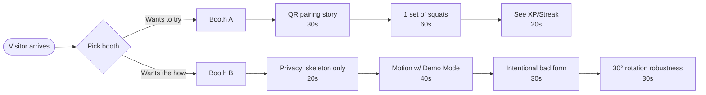
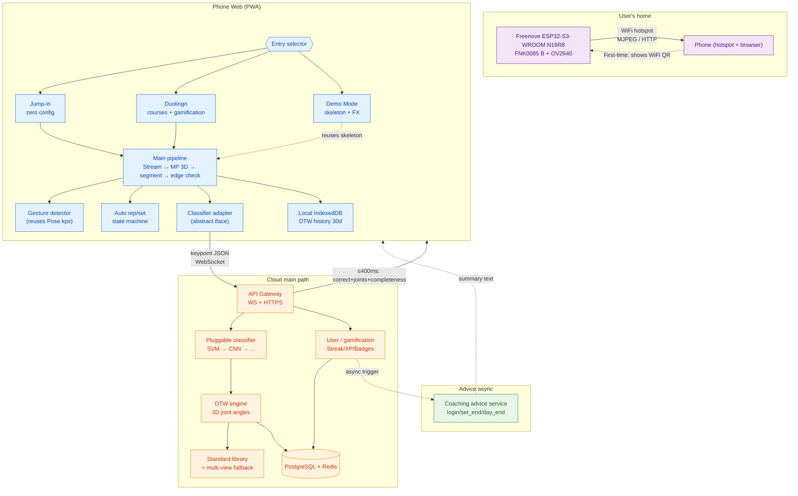
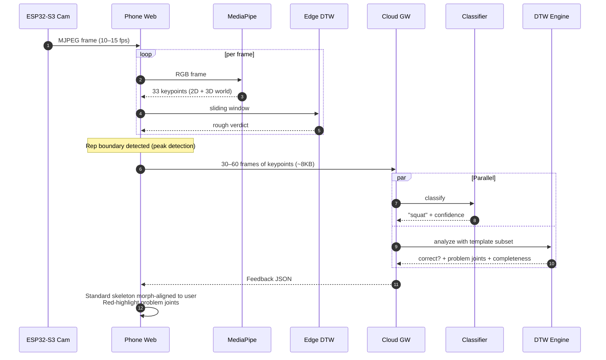
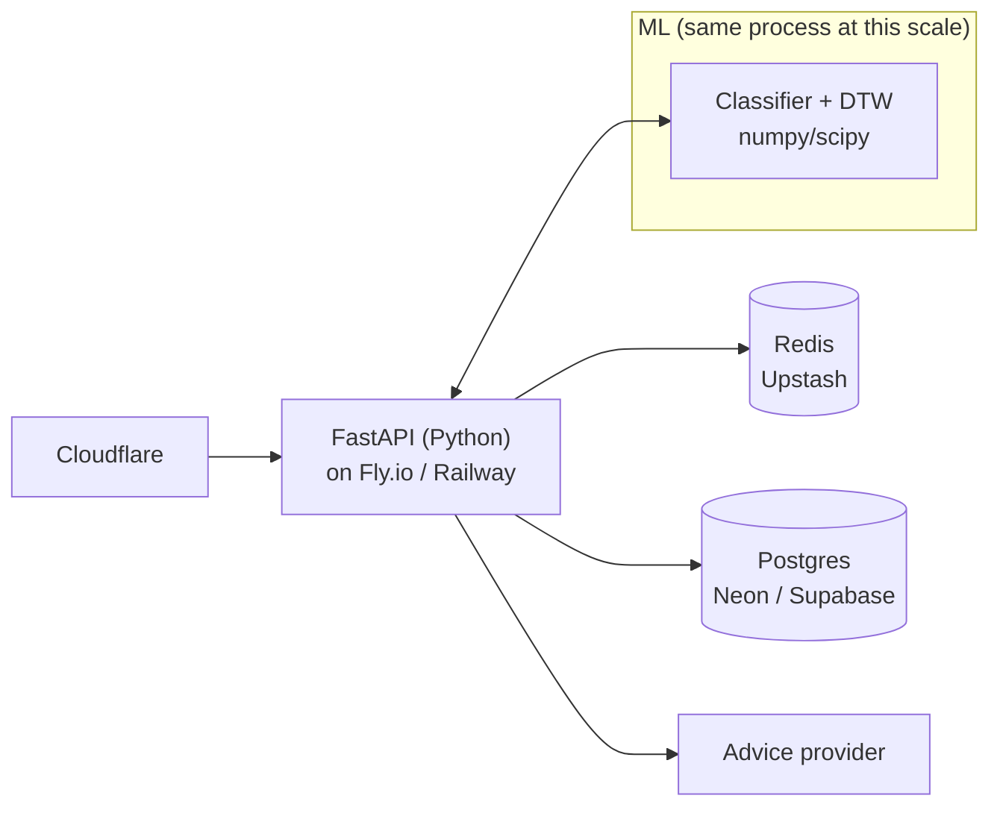
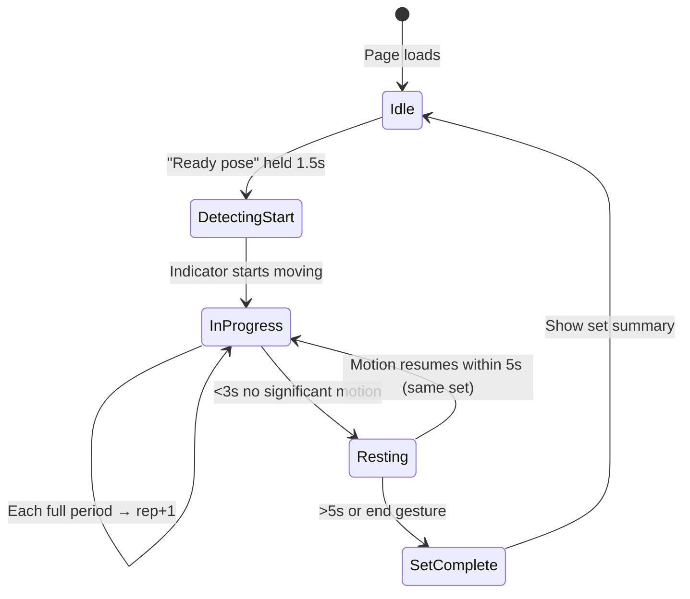
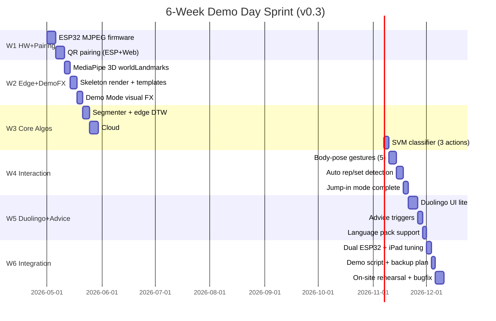

# KineticLife Motion Accuracy System — Architecture Design

> **Version**: v0.3
> **Primary Goal**: **Demo Day in 6 weeks** (live experience + main-function showcase in ideal conditions)
> **Secondary Goal**: 10–100 user pilot → reserved extensibility for 1000 users (not implemented before demo)
> **Core Stack**: Freenove ESP32-S3-WROOM Board (N16R8) FNK0085 B + OV2640 capture → Phone/iPad Web + MediaPipe 3D → Cloud DTW analysis → Duolingo-style guidance
> **Author**: Dennis

### v0.3 Changelog (from v0.2)

| # | Change | Rationale |
|---|--------|-----------|
| 1 | **Focused on 6-week Demo Day**; MVP compressed from 10–12 weeks to 6 | Demo Day is the primary milestone |
| 2 | Dual demo-booth design: phone full-experience booth + iPad main-function booth | Covers two user personas in parallel |
| 3 | iPad demo path allows higher latency | Users do a full set; response time is not critical |
| 4 | Added **body-pose gesture control** (reuses existing Pose keypoints) | Hands-free wow factor on stage |
| 5 | Added **automatic set/rep detection** (peak detection + DTW) | Replaces the manual button, dramatically better UX |
| 6 | **No face recognition on ESP32** | Resource conflict; do it on Web side if needed |
| 7 | New §10 **Scalability roadmap (10 → 1000 users)** | Reserved in design; not built before demo |
| 8 | Documentation consolidated under the current KineticLife naming scheme | Removes stale bilingual file-pair references |

### v0.2 Changelog (from v0.1)

- Async advice removed from critical path (main-path P95 target: 500ms -> **400ms**)
- Web entry split: **Jump-in** (zero-config) + **Duolingo** (guided)
- Introduced **pluggable classifier interface** (SVM is just the first implementation)
- ESP32 pairing switched to **WiFi QR code scan** (replaces SmartConfig)
- Added **Demo Mode**, **DTW history playback**, and **view-angle invariance** design

---

## Table of Contents

1. [Goals & Scope](#1-goals--scope)
2. [Overall Architecture](#2-overall-architecture)
3. [End-to-End Data Flow](#3-end-to-end-data-flow)
4. [Module Details](#4-module-details)
5. [Data Contracts](#5-data-contracts)
6. [Per-Module Tech Comparison](#6-per-module-tech-comparison)
7. [Non-Functional Requirements](#7-non-functional-requirements)
8. [MVP Roadmap](#8-mvp-roadmap-v03-6-week-sprint)
9. [Risks & Open Decisions](#9-risks--open-decisions)
10. [Scalability Roadmap](#10-scalability-roadmap)

---

## 1. Goals & Scope

### 1.1 User Stories (Two Entry Points)

**First-time setup (5 steps, ~2 minutes)**
1. User turns on phone hotspot -> opens Web App
2. Web asks for hotspot SSID + password (stored only in local IndexedDB) -> generates **WiFi QR code**
3. Power on ESP32-S3 (first boot -> pairing mode, blue LED blinking)
4. User holds phone screen toward ESP32 camera -> ESP32 scans QR -> connects (green LED solid)
5. Web auto-detects ESP32 online -> shows "Device connected"

**Daily training · Jump-in mode (experienced users, zero config)**
1. Open Web App -> tap "Jump-in" -> camera feed + skeleton appear immediately
2. User starts any motion (squat, pushup, anything) -> classifier rolls
3. System auto-detects motion type, counts reps, judges correctness — no interruption
4. Main-path response **≤ 400 ms** (coaching advice does not enter the critical path)

**Daily training · Duolingo mode (new users, guided)**
1. Login -> **async advice service generates today's suggestion from history** (prefetched while user browses)
2. Pick today's routine (e.g., squat × 15)
3. Enter training; each rep feedback ≤ 400 ms (no async advice on the main path)
4. End of set -> **async advice service gives set summary** (completeness: e.g., "motion correct but depth < 70%")
5. End of day -> **async advice service gives daily summary + tomorrow's suggestion**
6. Check-in, XP, streak, achievements updated

### 1.2 Design Principles

| # | Principle | Explanation |
|---|-----------|-------------|
| 1 | **Privacy first** | Raw video never leaves the phone; realtime landmarks are transient, and storage keeps only 14-D angles plus derived results |
| 2 | **Low-latency feedback** | Main path (correctness + problem joints) ≤ **400 ms P95**; async advice is out of critical path |
| 3 | **Offline degradation** | Bad network → still trainable; cloud feedback delayed, not blocked |
| 4 | **Swappable algorithms** | DTW, classifier, templates all independently iterable without touching the frontend |
| 5 | **Cost contained** | 10–100 users target: cloud spend < $50/month |

### 1.3 Demo Day Setup (Primary Milestone)

**When**: 6 weeks from now · **Where**: On-site booth · **Format**: Two parallel booths

#### Booth A — Phone Full-Experience Zone

| Element | Config |
|---------|--------|
| Hardware | Freenove ESP32-S3-WROOM FNK0085 B + OV2640 unit #1 + 1 phone (pre-provisioned) |
| Setup | ESP32 on fixed mount facing "training spot" 2m away; phone vertical beside it |
| Experience | Visitors use **the demo phone directly**, OR scan QR to **connect via their own phone** (new-user flow demo) |
| Focus | Duolingo guided flow, gamification UI, full user journey, QR-pairing story |
| Talking points | "Try 30 seconds of squats", "See your streak and badges", "Your own phone works too" |

#### Booth B — iPad Main-Function Demo Zone

| Element | Config |
|---------|--------|
| Hardware | Freenove ESP32-S3-WROOM FNK0085 B + OV2640 unit #2 + 1 iPad (landscape, large display) |
| Setup | ESP32 faces "training spot"; iPad shows skeleton + analysis on big screen |
| Experience | **Demo Mode** (pure skeleton + visual FX; no video shown) |
| Focus | **Privacy** (no video on screen) + **DTW accuracy** (joint analysis, error highlighting, multi-angle robustness) |
| Latency tolerance | Visitor completes a full set → 1–2 sec for fine analysis is acceptable |
| Talking points | "Video never leaves the device", "Watch the system spot the weak joint", "I rotate 30° — still works" |

#### Demo Script (2–3 min per visitor)



#### Ideal Conditions (Explicit Assumption)

Demo environment is pre-arranged (engineering fully controllable):
- Yes Close range (1.5–2 m)
- Yes Single person in frame
- Yes Mostly facing camera
- Yes Deliberate 30°/45° rotation demos to showcase robustness
- No extreme lighting, no crowd occlusion, no multi-person

#### 6-Week Reverse Schedule (~240–280 h)

| Week | Milestone | Key Deliverable |
|------|-----------|-----------------|
| W1 | ESP32 MJPEG + QR pairing works | Phone sees video; can configure WiFi |
| W2 | MediaPipe 3D + skeleton render + **Demo Mode v1** | Booth B visuals ready |
| W3 | Standard templates + 3D-angle DTW + accuracy demo | Errors are correctly highlighted |
| W4 | **Gestures + auto rep/set detection** + Jump-in | End-to-end zero-touch experience |
| W5 | Duolingo UI (lite) + async advice (3 triggers) | Booth A flow complete |
| W6 | Dual ESP32 deployment + iPad tuning + rehearsal + backup plan | Demo Day ready |

**Deferred past Demo**: DTW history playback (§4.8), multi-view template fallback, full user system (demo account only), classifier CNN upgrade.

### 1.4 Out of Scope

- Hardware mass production / enclosure design / battery (assume wired or USB-C)
- Payment / subscription system
- Multi-user social features (basic check-in only)
- Medical-grade rehab judgment

---

## 2. Overall Architecture

### 2.1 Container-Level Component Diagram



### 2.2 Layer Summary

| Layer | Device | Responsibility | Degradation |
|-------|--------|----------------|-------------|
| **Capture** | ESP32-S3 | Min-viable video (320×240 @ 10–15fps) | Firmware watchdog auto-reset |
| **Transport A** | Phone hotspot WiFi | ESP32 → Phone | UI guidance + last 3s frame cache |
| **Client** | Phone browser | MediaPipe 3D + edge check + UI | Re-use last good keypoints frame |
| **Transport B** | WiFi/4G | Phone → cloud (WebSocket) | Offline queue, replay on recovery |
| **Service** | Cloud | Classifier + DTW + async advice | Single service down -> degraded correctness-only mode |
| **Storage** | PostgreSQL + Redis | Users + template cache | Redis down → direct PG fallback |

---

## 3. End-to-End Data Flow

### 3.1 Sequence Diagram of One Rep



### 3.2 Critical Latency Budget (Main Path ≤ 400ms)

Main path **does not include** async advice calls.

| Stage | Budget | Note |
|-------|--------|------|
| ESP32 → Phone (last frame) | 50 ms | Local WiFi, MJPEG |
| MediaPipe 3D inference | 30–60 ms | worldLandmarks enabled |
| Rep boundary detection | 10 ms | Zero-crossing of joint velocity |
| Phone → Cloud | 80–150 ms | 4G 150ms / WiFi 40ms |
| Classifier + DTW (sequential) | 80–120 ms | Classifier prunes template set first |
| Cloud → Phone | 80–150 ms | Same |
| **P95 total** | **~350 ms** | Safely under 400 ms target |

**Async advice latency (outside main path)**:

| Trigger | When | User-perceived delay |
|---------|------|----------------------|
| Login | Prefetched while user picks course | 3–5 s |
| Set end | Inter-set stats card, streamed | 1–2 s |
| Day end | After check-in animation | 2–4 s |
| Consecutive-fail-3 | On the third same-joint error | Inline popup |

---

## 4. Module Details

### 4.1 ESP32-S3 + Cam Firmware

**Hardware baseline**: Freenove ESP32-S3-WROOM Board (N16R8), model FNK0085 B, with OV2640 camera.

**Firmware core**:
- **Auto mode select on boot**: NVS has credentials → connect directly; otherwise → **QR pairing mode**
- **QR pairing**: camera full-speed refresh; parse standard `WIFI:S:<ssid>;T:WPA;P:<pass>;;` via `quirc` library; write NVS then reboot
- HTTP server exposes `/stream` (multipart/x-mixed-replace MJPEG) and `/ctrl` (params)
- Quality tiers: `240x240@15fps` (default), `320x240@10fps` (low light), `160x120@20fps` (low latency)
- **LED status indicator** (single RGB):
  - Blue blink: pairing mode
  - Yellow blink: QR recognized, connecting
  - Green solid: online, HTTP serving
  - Red blink: connect failed (after 3 retries → re-enter pairing)
- Watchdog: WiFi disconnect 5s → reset
- **Reset button**: long-press 5s → clear NVS → back to pairing mode

**QR pairing vs alternatives**:

| Dimension | QR scan Yes | SmartConfig | BLE |
|-----------|-----------|-------------|-----|
| User understanding | Low (just hold up phone) | Medium | Medium |
| Success rate | High (if lighting ok) | Low (5 GHz router kills it) | High |
| Reuses camera | Yes (already there) | No | No |
| Firmware complexity | Low (`quirc` = a few hundred LOC) | Medium | High |

### 4.2 Phone Web Client (PWA)

**Stack**:
- **Framework**: React + Vite (or Svelte, smaller bundle)
- **Pose**: `@mediapipe/tasks-vision` `PoseLandmarker`, with `worldLandmarks` enabled
- **Rendering**: Canvas 2D (skeleton) + Tailwind (UI)
- **State**: Zustand
- **PWA**: "Add to home screen"; offline-capable UI

**Key directories**:
```
src/
  capture/            # MJPEG ingest + QR generator
  pose/               # MediaPipe wrapper (2D + 3D world_landmarks)
  edge-dtw/           # Lightweight DTW for instant rough feedback
  segmenter/          # Rep boundary detection (zero-crossings of joint velocity)
  classifier-client/  # Classifier adapter (abstract interface)
  gesture-detector/   # Body-pose gestures (§4.10)
  auto-set/           # Auto rep/set state machine (§4.11)
  renderer/           # Skeleton + morph-aligned standard pose
  demo-mode/          # Visual FX layer for Demo Day
  history/            # DTW history playback
  api/                # WebSocket client, reconnection, offline queue
  routes/             # entry / jump-in / duolingo / history-view
  store/              # Zustand global store
  pwa/                # Service Worker, IndexedDB
```

**Jump-in vs Duolingo differences**:

| Dim | Jump-in | Duolingo |
|-----|---------|----------|
| Time to first skeleton | ≤ 2s | After login + course pick |
| Classification | **Rolling auto-classify** | Already known from selected course |
| Confidence threshold | High (0.85+) | Low (0.6, prior known) |
| Counting | Same-class consecutive reps grouped | Follows preset rep count |
| Advice generation | None | login + set_end + day_end |
| Exit | Close tab, data stays local | Complete or abandon course |

### 4.3 Cloud Backend

**Deployment topology (pilot scale)**:



### 4.4 Pluggable Action Classifier

**Why abstract it**: SVM is the MVP implementation, but accuracy on real data may not suffice, especially in Jump-in mode (no priors, zero tolerance). Abstracting the classifier lets us swap in 1D-CNN, ST-GCN, or Transformer later without touching the rest.

**Interface**:
```python
from typing import Protocol
import numpy as np

class ActionClassifier(Protocol):
    def classify(
        self,
        keypoints_3d: np.ndarray,      # [T, 33, 3]  (world coords)
        joint_angles: np.ndarray,      # [T, N_joints]
        context: dict = None,          # Optional prior: {"expected": "squat"}
    ) -> ClassifyResult: ...

    @property
    def labels(self) -> list[str]: ...

class ClassifyResult:
    label: str                         # "squat" | "pushup" | "plank" | "unknown"
    confidence: float                  # 0.0 – 1.0
    top_k: list[tuple[str, float]]
    reject_reason: str | None          # "low_visibility" | "too_short" | None
```

**First implementation — SVM**:
- Features: joint-angle mean/variance/max/min + duration + principal motion direction (~30 dims)
- Model: RBF-SVM, `sklearn.svm.SVC(probability=True)`
- Training data: self-recorded + public sets (MM-Fit)

**Upgrade path**:
1. **1D-CNN** (temporal conv over keypoints) — better than SVM once you have >2000 samples
2. **ST-GCN** (spatio-temporal graph conv) — SOTA, uses 33-kp spatial graph
3. **Transformer** (e.g., TimesFormer small) — only after large-scale data

**Jump-in special handling**:
- Web maintains a 2-second rolling window; call classifier every 500 ms
- 3 consecutive same-label calls with confidence >0.85 → "user is doing X"
- Edge DTW starts in parallel
- Rep boundary detected → submit to cloud for fine analysis
- Classifier returns "unknown" continuously for >5s → UI guidance "no valid motion detected"

### 4.5 DTW Engine (core correctness judgment)

**Input**: `[T × 33 × 3]` 3D world landmarks.

**Preprocessing**:
1. Skeleton normalization: origin = hip midpoint; scale = shoulder-to-hip distance
2. Low-visibility (<0.3) → interpolate from neighbors
3. Resample to 30 frames

**DTW computation**:
- Don't compare keypoint coordinates (noisy!). Compare derived quantities:
  - **Joint angles** (knee, hip, elbow, shoulder) — most stable
  - Body-part relative distances (hand–foot, shoulder–hip)
  - Body-part relative velocities
- Weighted sum of per-feature DTW distances
- Threshold exceeded → "incorrect"
- Max-deviation along the DTW alignment path → "problem joints"

**Thresholds**:
- MVP: hand-label 20 "correct" + 20 "incorrect" samples, take the 95th percentile of correct distances
- Long-term: user feedback ("Was this right?") button → online tuning

### 4.6 Duolingo-Style Guidance

**Gamification**:
- XP: correct rep +10, incorrect +5
- Streak: break = reset (with a "shield" item for recovery)
- Achievements: first time doing X, 7-day streak, ≥90% accuracy, etc.
- Daily goal bar
- **Completeness** (v0.2+): "motion correct but didn't complete full range" — tracked as ratio of user's extreme joint angle / standard's extreme. <70% gives reminder.

**Async advice triggers (all async, off main path)**:

| Trigger | Input | Output | User sees |
|---------|-------|--------|-----------|
| **Login** | Last 7 days + today's context + last-failed motion | Today's training suggestion (30–50 words) | Prefetched while picking course |
| **Set end** | This set's N reps + problem-joint frequencies + avg completeness | Set summary + next-set cue (≤ 40 words) | On the inter-set stats card, streamed |
| **Day end** | Today's full data + streak + 3-day trend | Encouragement + tomorrow's suggestion | After check-in animation |
| **3 consecutive fails** | Specific problem-joint details | Detailed correction (80–120 words) | Popup after the 3rd rep |

**Cost control**:
- Low-cost provider tier
- Login summary cached 24h
- Per-user daily cap: 10 calls; overflow → local templated fallback
- 100 users × 10/day × $0.0004 ≈ **$12/month**

### 4.7 Demo Mode (Demo Day Special)

**Goal**: iPad on the table, user stands in front, screen shows **skeleton + visual FX only** — no camera feed. Reinforces privacy messaging + looks cool.

**Visual recipe (one implementation)**:

| Element | Effect | How |
|---------|--------|-----|
| Background | Dark gradient + slow-flowing particle grid | Canvas 2D + RAF |
| Skeleton | White gradient lines, glowing joint orbs | Canvas 2D with `shadowBlur` |
| Trails | Hand/foot motion 2-second trails | Circular buffer of recent 30 frames |
| Particles | Burst on successful rep | Simple particle system |
| Audio | "ding" correct / "ping" error | Web Audio API |
| Rep counter | Big number in corner | Direct DOM |
| Joint highlight | Pulsing red on error | Animate joint orb radius + color |

**Why not Three.js**: 2D Canvas is already stunning for this; Three.js adds bundle size and learning cost; 30 FPS on iPad is more stable in 2D.

### 4.8 DTW History Playback

**Stored**: keypoint sequences (~8 KB/rep), verdicts, timestamps. **Not stored**: video, raw frames, audio.

- **Client IndexedDB**: recent 30 days (fast playback)
- **Cloud Postgres**: compressed long-term

**Storage estimate**: 50 reps/day × 9 KB = 450 KB/day × 100 users ≈ 1.3 GB/month (within free tiers).

**Playback UI**: skeleton animation (adjustable speed), "you vs standard" side-by-side with Procrustes alignment, problem-frame markers on timeline, export as GIF for sharing (keypoints only — privacy-safe).

**Priority**: defer to after Demo Day.

### 4.9 View-Angle Invariance (Answers question 5-3)

**Problem**: Standard motions recorded at 0° (frontal), users may be 30–45° off-axis. DTW on 2D coordinates / 2D angles fails because relative joint positions in 2D projection change with viewpoint.

**Approach comparison**:

| Option | Range covered | Implementation | Template cost | Recommended |
|--------|---------------|----------------|---------------|-------------|
| A. Multi-view templates (0/30/60/90°) | Any | Low | 4x | No, not first choice |
| B. **MediaPipe 3D world_landmarks + pure 3D joint angles** | 0-45° good, 45-60° usable | Low-medium | 1x | Primary |
| C. Learn a view-normalization network | Wide | High | 1x + data | No, overkill |
| D. Force users to stand at marked spot | Fixed 0° | Low | 1x | Avoid; reduces flexibility |
| E. **B + A fallback** (extreme angles only) | Any | Medium | 2-3x | Long-term |

**Why B is primary**: MediaPipe's `worldLandmarks` are 3D coordinates (meters) with origin at the pelvis. Joint angles computed from 3D vectors are **view-invariant by construction** — the knee angle is the same regardless of camera position.

**DTW uses 14 3D joint angles only**:
```
knee angle = angle(hip→knee, knee→ankle)
elbow angle = angle(shoulder→elbow, elbow→wrist)
hip angle = angle(torso→hip, hip→knee)
torso flexion = angle(shoulder-mid → hip-mid, vertical)
... (14 total)
```

**Validation plan (1 week)**:
1. Record the same motion at 0°, 30°, 45°, 60° × 20 samples each
2. Plot the 14 angle time-series
3. If 0° and 45° curves overlap → Option B works alone
4. If 45° diverges → add Option A fallback

**Pipeline**:
1. MediaPipe config: `runningMode: VIDEO`, `outputSegmentationMasks: false`, **enable worldLandmarks**
2. Features: compute angles from `worldLandmarks`; ignore 2D `landmarks`
3. DTW input: `[T, 14]` angle series — 10× smaller than `[T, 33, 3]`
4. Standard library: one view (0°), recorded with subject facing camera

**Edge cases**:
- Lateral 90° for lower-body moves (e.g., knee alignment visible only from side) → UI guidance "face the camera"
- Severe occlusion → confidence filtering, skip the frame

**Verdict**: Don't pre-emptively record multi-view templates. Validate first, then decide.

---

### 4.10 Body-Pose Gestures (v0.3)

**Decision: YES.** Uses existing Pose keypoints, zero extra CPU.

**Why not Hand Landmarker**: Adds 20–40 ms/frame on mobile, hand kps are noisy at KineticLife distance. We only need 4–5 coarse gestures → **synthesize from Pose 33 kps**.

**Gesture vocabulary (v1, all detectable from Pose)**:

| Gesture | Definition | Trigger |
|---------|-----------|---------|
| Both hands overhead (1.5s hold) | `left_wrist.y < nose.y AND right_wrist.y < nose.y` | Start training / confirm |
| Arms crossed in front (1.5s) | `left_wrist.x > right_shoulder.x AND vice versa, y ~chest` | End current set / cancel |
| One hand overhead | One-sided `wrist.y < nose.y` | Pause / resume |
| T-Pose (2s) | Wrists level with shoulders, spread > 1.5× shoulder width | Calibrate / reset |
| Point at camera (1s) | `wrist.z - shoulder.z < threshold` (uses 3D z) | Cycle display |

**Implementation**:
- Add `gesture-detector.js` to the Pose pipeline
- Input: Pose landmarks per frame (already available)
- Output: current gesture + hold duration
- Debounce: same gesture cannot retrigger within 3s
- UI feedback: radial progress bar on screen edge while detecting

**Demo Day moment**: Presenter raises hands -> system starts. Crosses arms -> system ends. **Zero-touch**.

**Accuracy**: >98% correct detection, <2% false trigger (in ideal demo conditions). These are extreme poses with clean signatures.

### 4.11 Automatic Rep/Set Detection (v0.3)

**Decision: YES.** DTW + peak detection supports this. Replaces the manual button (dreadful UX, last resort).

**Algorithm**: Per-exercise "key indicator" whose periodic extrema mark reps.

| Exercise | Key indicator | One complete rep |
|----------|---------------|------------------|
| Squat | Hip midpoint y (3D) | Low → back to start |
| Pushup | Chest midpoint y (3D) | Low → back to start |
| Plank | (Not periodic — use stable duration) | Hold pose ≥ 30s |
| Bicep curl | Elbow angle | Extended → flexed → extended |

**State machine**:


**Rep cycle detection**:
- Moving-average the key indicator (5-frame window)
- `scipy.signal.find_peaks` for extrema (JS: simple self-rolled version)
- Adjacent same-direction extrema = 1 rep
- DTW-check the cycle shape to reject false counts (e.g., scratching head ≠ squat)

**Sub-set segmentation within a big workout**:
- Overall keypoint velocity as motion intensity
- 3+ seconds low → resting
- Resume → new sub-set
- UI shows "Set 1: 10 reps / Set 2: 8 reps / ..."

**Demo value**: Visitor does any reps with any breaks; screen counts + segments live, no interaction.

### 4.12 Face Recognition on ESP32 (v0.3 Decision)

**Decision: No, not on ESP32.** If needed, do it on the Web side with MediaPipe Face Landmarker.

**Why ESP32 can't (while also streaming MJPEG)**:

| Resource | MJPEG stream usage | Face recognition overhead | Conflict |
|----------|-------------------|---------------------------|----------|
| CPU (240 MHz dual-core) | 1 core at JPEG encode @ 15 fps | 1 core runs MTCNN/BlazeFace + embedding | Tight |
| PSRAM | Frame buffer ~1.5 MB | Model weights + workspace ~3-4 MB | Tight |
| WiFi bandwidth | Saturated by MJPEG | No extra | OK |
| Measured FPS | ~15 | Drops to ~5-8 | Halved |

**Web-side face recognition — preferred**:
- Phone CPU/GPU is plentiful (MediaPipe Face Mesh does 60+ FPS)
- Already has decoded MJPEG frames
- Can be correlated with Pose easily
- Doesn't destabilize ESP32 capture

**Demo Day need?** No — Booth B is guest-only; Booth A can use an explicit "switch user" button. **Defer.**

---

## 5. Data Contracts

### 5.1 ESP32 → Phone (MJPEG)
```
GET http://192.168.43.X/stream
Content-Type: multipart/x-mixed-replace; boundary=frame
```

### 5.1.1 WiFi QR Format
```
WIFI:S:MyPhoneHotspot;T:WPA;P:my_password_123;;
```
Standard WiFi QR format — compatible with any QR scanner library. ESP32 uses `quirc` to parse.

### 5.2 Phone -> Cloud (WebSocket)

Archived sketch only. The current source of truth is [`../04_Interface_Contracts.md`](../04_Interface_Contracts.md), especially `client.keypoints`, `client.action_submit`, and `server.feedback`.
```json
{
  "type": "client.action_submit",
  "session_id": "uuid",
  "exercise_hint": "squat",
  "timestamp_start": 1729000000.123,
  "timestamp_end": 1729000002.456,
  "keypoints_3d": [[[0.52, 0.31, 0.0, 0.98], ...]],
  "client_edge_flag": "suspect_knee"
}
```

### 5.3 Cloud -> Phone (Main-path Feedback)
```json
{
  "type": "server.feedback",
  "correct": false,
  "confidence": 0.87,
  "classified_as": "squat",
  "classifier_confidence": 0.95,
  "problem_joints": [
    {"joint": "left_knee", "severity": 0.72, "issue": "valgus"},
    {"joint": "lumbar", "severity": 0.41, "issue": "rounded"}
  ],
  "completeness": 0.68,
  "completeness_note": "Depth below 70% of standard",
  "dtw_distance": 3.42,
  "threshold": 2.10,
  "reference_template_id": "squat_standard_v2",
  "xp_earned": 5
}
```

### 5.3.1 Cloud -> Phone (Async Advice Message)
```json
{
  "type": "server.advice_tip",
  "scope": "set_end" | "day_end" | "login" | "consecutive_fail",
  "text": "Set overall completeness 85%; knee valgus cut in half vs. last week. Keep it up.",
  "generated_at": "2026-04-24T10:23:41Z"
}
```

### 5.3.2 Jump-in Events
```json
// Client-side rolling classification (internal)
{
  "type": "jumpin.class_update",
  "rolling_label": "squat",
  "rolling_confidence": 0.91,
  "frames_observed": 48
}

// Submission after one set
{
  "type": "jumpin.set_complete",
  "label": "squat",
  "rep_count": 12,
  "correct_count": 9,
  "avg_completeness": 0.82
}
```

### 5.4 Advice Copy Rules

- 1-2 sentences, no more than 40 words
- Specific and actionable; reference the detected joint or range-of-motion issue
- No generic filler, medical diagnoses, or professional-care claims

---

## 6. Per-Module Tech Comparison

### 6.1 ESP32 Video Transport

| Option | Latency | Bandwidth | Browser-native | Dev difficulty | Pick |
|--------|---------|-----------|----------------|----------------|------|
| **MJPEG over HTTP** | ~100ms | High (500kbps@240p) | Yes `` | Low | **MVP pick** |
| WebRTC | <100ms | Low | Yes | High | Later |
| RTSP + phone transcode | ~150ms | Medium | No | Medium | No |
| BLE only | >300ms | Tiny | No | High | No |

### 6.2 Pose Library

| Library | FPS (phone) | Keypoints | Accuracy | Bundle | Note |
|---------|------------|-----------|----------|--------|------|
| **MediaPipe Pose Landmarker** | 30–60 | 33 | High | ~5 MB | **Pick** |
| MoveNet Lightning (TFJS) | 40–80 | 17 | Medium | ~3 MB | Fastest |
| MoveNet Thunder (TFJS) | 15–30 | 17 | Higher | ~12 MB | Balanced |
| Old BlazePose | 20–40 | 33 | High | ~7 MB | Superseded |

### 6.3 DTW Library (Python)

| Library | Speed | Multi-dim | API | Note |
|---------|-------|-----------|-----|------|
| **dtaidistance** | Very fast (C) | Yes | Clean | **Pick** |
| fastdtw | Medium (approx) | Yes | Simple | Speed-vs-accuracy tradeoff |
| tslearn | Medium | Yes | Rich | Has other time-series tools |
| Hand-rolled NumPy | Slow | Yes | Flexible | Prototype only |

### 6.4 Backend Framework

| Framework | WebSocket | Concurrency | ML ecosystem | Pick |
|-----------|-----------|-------------|--------------|------|
| **FastAPI** | Native | asyncio | Python = numpy/sklearn direct | **Pick** |
| Node + Express | Supported by ws library | Event loop | Need separate Python ML svc | No |
| Go + Fiber | Supported | Goroutine | Weak ML | No |

### 6.5 Cloud Platform (Pilot Scale)

| Platform | Monthly cost | Deploy difficulty | WebSocket | Pick |
|----------|--------------|-------------------|-----------|------|
| **Fly.io + Neon + Upstash** | $5-20 | Medium | Yes | **Pick** |
| Railway | $10-30 | Low | Yes | Simplest, pricier |
| AWS (EC2 t4g.small + RDS) | $30-50 | High | Yes | Educational |
| Vercel + Serverless | $5+ | Medium | No long WS | **No** |

---

## 7. Non-Functional Requirements

| Dimension | Target | Mechanism |
|-----------|--------|-----------|
| **Latency** | Main path ≤ 400ms P95 | Advice generation out of critical path; classifier→DTW sequential |
| **Availability** | 99% | Single-region; client-side retry |
| **Privacy** | No recoverable video info | Transient pose signals only; persistent records store 14-D joint angles and derived results |
| **Security** | Only legit user uploads | JWT short-token; WS first-frame handshake |
| **Cost** | < $50/month | Scale-to-zero FastAPI + low-cost advice generation |
| **Observability** | Key metrics dashboarded | Grafana Cloud free tier + Sentry |
| **Testability** | Algorithm regressions blocked | Labeled dataset + unit tests + metric gates |

### 7.1 Privacy Details (user-facing)
1. **No video upload**: MediaPipe runs in-browser; cloud never receives raw frames
2. **Visible banner**: "No video upload; only pose signals are analyzed"
3. **Data minimization**: transient landmarks support realtime feedback; persistent records keep only 14-D joint angles and derived results
4. **User data export/delete**: GDPR-style self-service

---

## 8. MVP Roadmap (v0.3 · 6-week sprint)

### 8.1 Gantt



### 8.2 Acceptance Criteria

**W1**: QR scan completes within 15s; phone displays live stream at ≥20 FPS for 5 minutes without drop.

**W2**: MediaPipe 3D skeleton overlays at ≥20 FPS on mid-range Android; Demo Mode FX run at 30 FPS on iPad.

**W3**: 3 standard exercises recorded; 3D-angle DTW correctly distinguishes "correct" vs "knee valgus" at ≥85% on 20-sample labeled set.

**W4**: 5 gestures recognized at >95% in ideal conditions; auto rep counting has 0 miscounts across 10 sets of 10 reps; Jump-in ready end-to-end.

**W5**: Duolingo flow (course pick -> train -> check-in) complete; async advice fires at 3 trigger points; language pack support works.

**W6**: Both booths deployed and rehearsed; backup plan for WiFi failure, ESP32 crash, cloud outage tested.

---

## 9. Risks & Open Decisions

### 9.1 Top Risks

| Risk | Probability | Impact | Mitigation |
|------|-------------|--------|-----------|
| ESP32 low-light noise breaks MediaPipe | High | High | Add fill light; lock white balance; fallback to OV5640 |
| MediaPipe <15 FPS on mid-range Android | Medium | High | Offer MoveNet fallback; low-FPS segmenter path |
| DTW threshold fails to generalize across bodies | High | Medium | Normalize + personalized tuning from 3 sample reps |
| Advice generation cost blows up | Low | Medium | Caching + per-user daily cap |
| WebSocket drops in weak network | Medium | Medium | IndexedDB offline queue + replay |
| **Demo Day hardware/network failure** | Medium | **Critical** | **Fully offline fallback mode**; pre-recorded demo video as last resort |

### 9.2 Open Decisions (Dennis input needed)

1. **Source of standard motion templates?**
   - (A) Record yourself
   - (B) Public dataset (MM-Fit)
   - (C) KineticLife coach friend

2. **First 3 exercises to support?**
   - Recommendation: **squat, pushup, plank** (covers lower/upper/core; single camera angle)

3. **ESP32 dev board**
   - Baseline fixed to **Freenove ESP32-S3-WROOM Board (N16R8), FNK0085 B**
   - Camera fixed to **OV2640**
   - Any alternate board needs a separate pin-map and calibration note

---

## 10. Scalability Roadmap

> **Not built before Demo Day.** This chapter is reserved for design; useful for PPT and future conversations.

### 10.1 Evolution Path by Scale

| Scale | Architecture change | New components | Monthly cost |
|-------|---------------------|----------------|--------------|
| 10–100 (pilot/demo) | Monolithic FastAPI on Fly.io + single Postgres | None | <$30 |
| 100–500 | Monolith + Redis cache + managed Postgres tier-up | Upstash Redis | $50–100 |
| 500–2000 | Horizontal API (3–5 instances) + extract classifier/DTW | ML workers + queue | $150–400 |
| 2000+ | K8s + per-user sharding + hosted ML inference | Modal / Replicate | $500+ |

### 10.2 Pre-Reserved Abstractions (do right now, even at pilot)

| Point of abstraction | Current impl | Future swap-in | Reservation |
|----------------------|--------------|----------------|-------------|
| Classifier | SVM | CNN / ST-GCN / Transformer | Python `Protocol` (§4.4) |
| Standard template store | Postgres JSONB | S3 + CDN | `TemplateStore` ABC |
| DTW engine | Same-process NumPy | Independent ML worker | `ClassifyResult` + queue |
| Advice service | Direct provider call | Multi-provider router | `AdviceProvider` interface |
| User session | Memory + Postgres | Redis distributed | Use Redis client wrapper from day 1 |
| Message transport | Direct WebSocket | WebSocket + Pub/Sub | Abstract `EventBus` |

### 10.3 One-Slide Pitch (Investor / Reviewer)

> "The current system supports ~100 concurrent users on a single node. Six critical points in the architecture are already abstracted behind swappable interfaces: classifier, template store, DTW engine, advice provider, sessions, and event bus. At 500+ users, the §10.1 path upgrades each layer in place, with estimated operational cost <$500 per upgrade step."

---

## 11. Document Naming

Current project documentation uses the KineticLife name and the files present in this repository. Older language-pair file names are retired; use the canonical docs under `docs/` and this archive folder for historical context only.

---

*This document evolves with the project. Please bump the version number of the relevant section when making new technical decisions or scope changes.*
